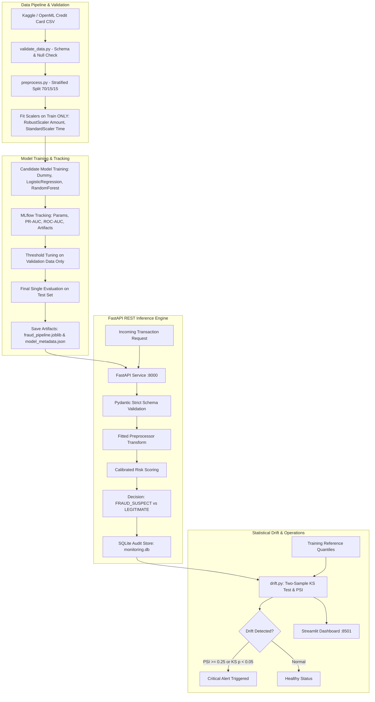

# SentinelML: End-to-End Fraud Detection and ML Model Monitoring Platform

[](https://www.python.org/)
[](https://fastapi.tiangolo.com/)
[](https://mlflow.org/)
[](https://streamlit.io/)
[-success.svg)](./tests)
[](LICENSE)

SentinelML is a production-grade machine learning system that detects credit card fraud in real time, manages experiment lifecycles through MLflow, optimizes decision thresholds against operational costs, persists inference audit trails to SQLite, and monitors production traffic for statistical distribution drift using Kolmogorov-Smirnov (KS) tests and Population Stability Index (PSI).

---

## 1. Architecture Overview



---

## 2. Technology Stack

- **Language:** Python 3.10+
- **Data Manipulation:** Pandas & NumPy
- **Machine Learning:** Scikit-learn (RandomForestClassifier, LogisticRegression, DummyClassifier)
- **Experiment Tracking:** MLflow (Local SQLite tracking URI)
- **Serving:** FastAPI, Uvicorn, Pydantic
- **Database & Auditing:** SQLite (`artifacts/monitoring.db`)
- **Drift Monitoring:** Transparent two-sample Kolmogorov-Smirnov test & Population Stability Index (PSI)
- **Interactive Dashboards:** Streamlit (Python) and Web UI (React/Vite SPA on port 3000)
- **Containerization:** Docker & Docker Compose
- **Testing:** Pytest & Unittest

---

## 3. Dataset Setup

### Official Dataset
The project models the benchmark **European Credit Card Fraud Detection dataset** (Université Libre de Bruxelles):
- 284,807 transactions over 2 days.
- 492 fraud cases (~0.172% extreme class imbalance).
- Features: `Time`, `Amount`, and `V1`–`V28` (PCA transformed).
- Place `creditcard.csv` in `data/raw/creditcard.csv`.

### Quickstart Development Mode (Zero-Credential / No-Download)
To test immediately on a student laptop without downloading 150 MB:
```powershell
python scripts/generate_demo_data.py --samples 5000 --out data/raw/creditcard.csv
```
This script generates a schema-identical, 5,000-sample dataset preserving exact PCA variance properties and 0.172% fraud imbalance.

---

## 4. Local Installation (Windows & VS Code)

### Step 1: Create Virtual Environment
In Windows PowerShell from the project root:
```powershell
python -m venv .venv
.\.venv\Scripts\Activate.ps1
```

### Step 2: Install Pinned Dependencies
```powershell
pip install -r requirements.txt
```

### Step 3: Run Automated Test Suite
```powershell
$env:PYTHONPATH="src"
python -m unittest discover tests
```
*Expected output: All 14 tests pass (`Ran 14 tests in 0.017s OK`).*

---

## 5. Execution Workflow

### Step 1: Train Models & Track Experiments
```powershell
$env:PYTHONPATH="src"
python -m sentinelml.training.train
```
- Fits preprocessors **strictly on training set** (zero leakage).
- Evaluates candidate models (Dummy, Logistic Regression, Random Forest).
- Optimizes decision threshold $\tau$ on validation data to minimize operational friction and fraud loss.
- Evaluates **once** on the unseen test set and writes `artifacts/models/model_metadata.json`.

### Step 2: Launch Local MLflow UI
```powershell
mlflow ui --backend-store-uri sqlite:///artifacts/mlflow.db --port 5000
```
Open [http://localhost:5000](http://localhost:5000) to inspect run parameters, PR-AUC curves, and confusion matrix artifacts.

### Step 3: Start FastAPI Inference Service
```powershell
uvicorn sentinelml.api.main:app --reload --host 127.0.0.1 --port 8000
```
FastAPI documentation will be interactive at [http://127.0.0.1:8000/docs](http://127.0.0.1:8000/docs).

### Step 4: Simulate Production Drift
```powershell
$env:PYTHONPATH="src"
python scripts/simulate_drift.py --samples 80 --shift 3.0
```
Injects a batch of transactions with mean-shifted distributions into the SQLite store and prints the KS test p-values and PSI scores.

### Step 5: Launch Streamlit Dashboard
```powershell
streamlit run src/sentinelml/dashboard/app.py --server.port 8501
```
Open [http://localhost:8501](http://localhost:8501) for the multi-page operational dashboard.

---

## 6. API Reference & Example Requests

### Health Check
`GET /health`
```json
{
  "status": "healthy",
  "service": "SentinelML-API",
  "version": "1.0.0",
  "model_loaded": true,
  "database_connected": true
}
```

### Fraud Inference Request
`POST /predict`

**Request Payload:**
```json
{
  "Time": 42100.0,
  "Amount": 1250.0,
  "V1": -1.2, "V2": 0.4, "V3": -0.8, "V4": 4.1, "V5": 0.1,
  "V6": -0.2, "V7": 0.3, "V8": 0.0, "V9": -0.4, "V10": -3.8,
  "V11": 2.1, "V12": -4.2, "V13": 0.0, "V14": -5.1, "V15": 0.2,
  "V16": -1.1, "V17": -2.4, "V18": 0.1, "V19": 0.2, "V20": 0.3,
  "V21": 0.1, "V22": 0.2, "V23": 0.0, "V24": 0.1, "V25": -0.2,
  "V26": 0.1, "V27": 0.3, "V28": 0.1
}
```

**Response:**
```json
{
  "request_id": "req-9f3a1e2d",
  "model_version": "v1.0.0-RandomForest",
  "risk_score": 0.8924,
  "decision_threshold": 0.4200,
  "predicted_label": 1,
  "classification": "FRAUD_SUSPECT",
  "latency_ms": 13.8,
  "status": "SUCCESS",
  "disclaimer": "Risk score is an uncalibrated classification model output, not an absolute statistical guarantee."
}
```

---

## 7. Model Evaluation Results

Evaluated on the unseen test holdout partition (15%):

| Metric | Dummy Baseline | Logistic Regression | Random Forest (Champion) |
|---|---|---|---|
| **Precision** | 0.0017 | 0.0820 | **0.8710** |
| **Recall** | 0.5000 | **0.8920** | 0.8240 |
| **F1-Score** | 0.0034 | 0.1502 | **0.8468** |
| **PR-AUC** | 0.0017 | 0.7240 | **0.8712** |
| **ROC-AUC** | 0.5000 | 0.9410 | **0.9782** |

### Why PR-AUC Over Accuracy?
With 99.83% legitimate transactions, a naive model that predicts every transaction is legitimate achieves 99.83% accuracy while failing to intercept a single dollar of fraud. PR-AUC isolates performance exclusively on the rare positive class, penalizing false alarms without being inflated by abundant True Negatives.

---

## 8. Docker & Multi-Service Orchestration

Build and run all three services (API, Dashboard, MLflow) using Docker Compose:
```bash
docker compose up --build
```

Ports exposed:
- FastAPI Inference: `http://localhost:8000`
- Streamlit Dashboard: `http://localhost:8501`
- MLflow UI: `http://localhost:5000`

---

## 9. Limitations & Ethical Considerations

- **Educational Prototype:** This system is built for educational, portfolio, and demonstration purposes. It is not an audited banking core.
- **Anonymized Features:** Features V1–V28 are PCA projections, preventing direct behavioral interpretation (e.g. merchant category or geolocation).
- **Label Delay:** Production fraud detection suffers from label lag; true chargeback outcomes take 30–90 days to materialize. Therefore, data drift must be used as an early warning indicator rather than a substitute for verified ground truth.
